# Etereshop Effects Recorder

A small program for Etereshop LED products: record, preview and create effects and put them on the controller's memory card.

> **Beta.** The program is still in beta development, so glitches and lags are possible. If something does not work or you have a question, please write to **sales@etereshop.com**.

**Video guide:** https://youtu.be/7uFBYAGUDzY. This is an informal screen recording for now, made so it is easier to see how everything works.

---

## Download

Download the archive for your system from the **[latest release](https://github.com/etereshop-sales/Etereshop-Effects-Recorder/releases/latest)**:

| System | File | How to start |
|---|---|---|
| Windows | `Etereshop_Effects_Recorder_Windows.zip` | `Etereshop Effects Recorder.exe` (Java is already inside) |
| macOS | `Etereshop_Effects_Recorder_Mac.zip` | `Effects Recorder.command`. Install Java first from [adoptium.net](https://adoptium.net); the first time, right-click the file → Open → Open |
| Any system with Java | `Etereshop_Effects_Recorder_Java.zip` | `java -jar EffectsRecorder.jar` |

## Quick start

1. **Download the archive and unzip it.** This is a portable version: nothing to install, it is ready to use.
2. **Start the program:** double-click the `.exe` on Windows or the `.command` file on a Mac.
3. **First of all, load the Madrix project of your product** in the **Product map** field at the top of the window (click **…**). We send this file together with the product (`.msx`, `.mpx` or Patch `.html`). This turns on every function of the program that you will need.

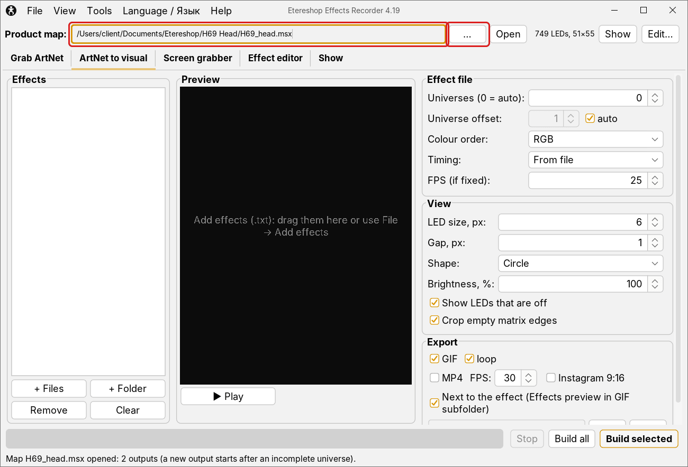

That's it. Below is what each tab does and which ones you will most likely use.

---

## Tabs

### Grab ArtNet: only if you have Madrix (or similar)
This tab records effects from other programs that send ArtNet, such as **Madrix**, Resolume or Jinx!. It does the same job as our previous recording software.

- **If you do not have Madrix or a similar program on your computer, you most likely don't need this tab.**
- If you do have Madrix: the difference from the old program is that you **don't need to type IP addresses**. Play an effect in Madrix and press **Find by ArtNet**. The program listens to the network and finds the IP address that is receiving the ArtNet signal.

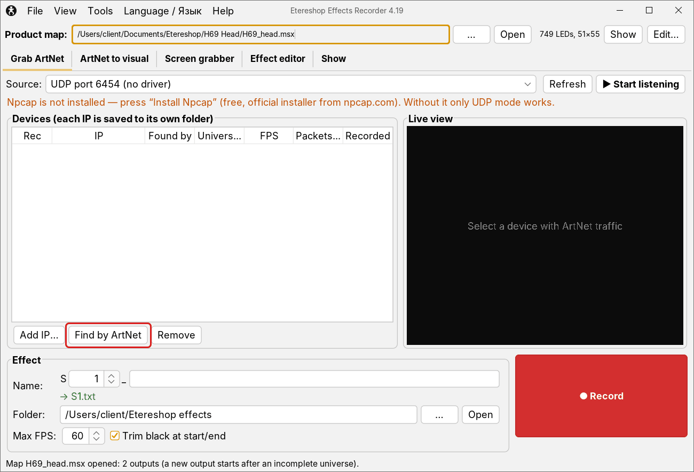

### Screen grabber: effects from any GIF or video
This is the tab you will most likely use. It lets you use **any GIF or video** as material for an effect: open the GIF or video on your screen, press **Show overlay**, put the overlay window over the picture and record.

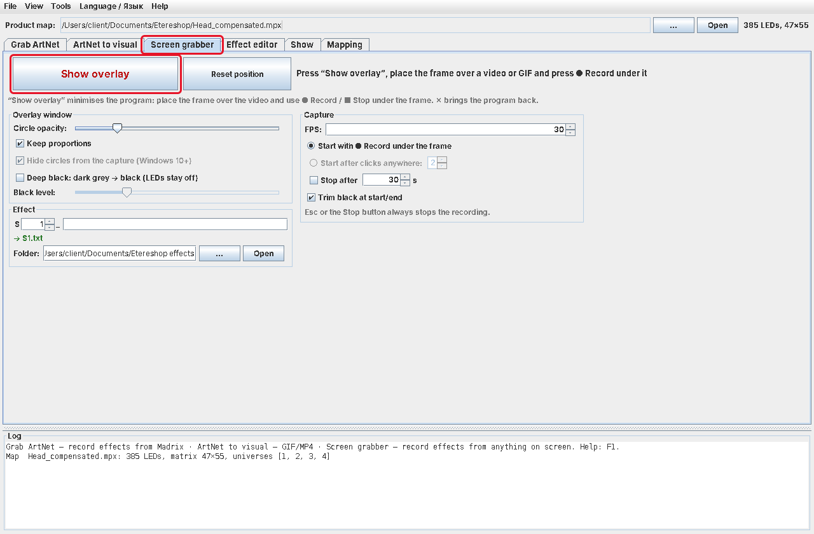

### ArtNet to visual: preview
Every effect you record (in any tab) appears here. **Record an effect → it appears in ArtNet to visual → check how it will look on the product.**

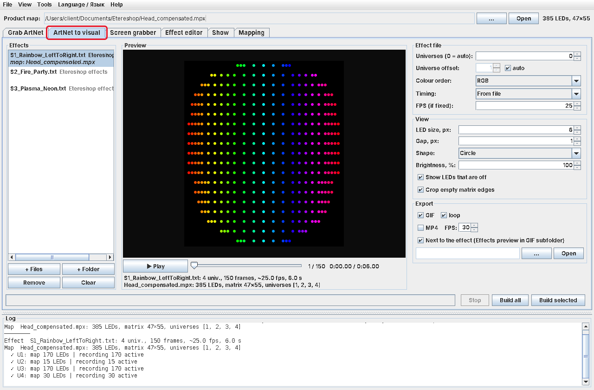

### Effect editor: create your own effects
Think of it as a "Madrix lite": you build effects from layers.

- **+ Layer** adds an effects layer. In the right column choose **Mode**: colours, fire, rainbows, rings, plasma, twinkle and more.
- **+ Image/GIF** adds a picture or a GIF as a separate layer.
- **+ Text** adds a separate text layer.

**Animating a picture.** An Image/GIF layer has an **Animation** block: zoom (grow then shrink, shrink then grow, grow from zero), movement in any direction with an optional **Seamless** mode (the picture repeats while it moves), and **Copies** (like Tile count in Madrix: the picture gets smaller and repeats). All of them work together.

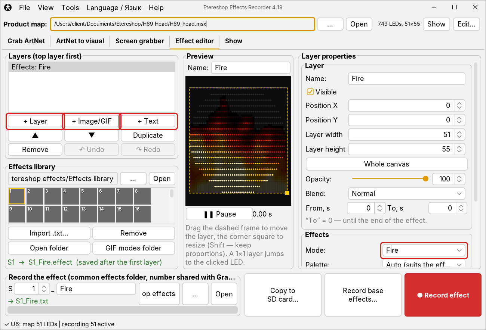

**GIF modes.** In the lower left corner there is a **GIF modes folder** button. Every GIF you put into this folder becomes a mode: it appears in the **Mode** list of an effects layer. So there are two ways to use a GIF: add it as **+ Image/GIF**, or put it into the GIF modes folder and pick it as a mode.

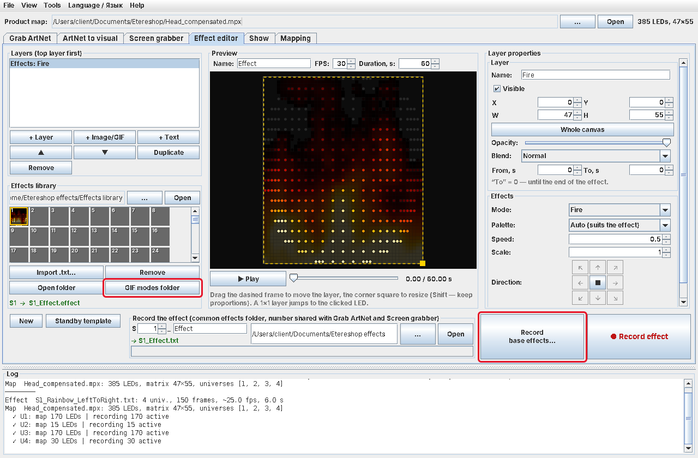

**Record base effects.** Why bother with the GIF modes folder? Say you go to a site like giphy.com, download 300 GIFs and put them into the folder. Then the **Record base effects…** button in the lower right corner records **95 standard effects plus one effect for every GIF**, which is 300 + 95 effects in one go.

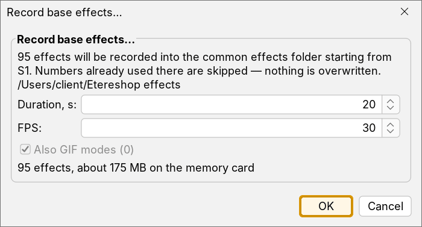

> ⚠️ **Be careful, this is a lot of data:**
> - check that it fits on the memory card (the dialog shows the estimated size before recording);
> - **don't set the length of one effect below 15 seconds.** When effects switch very often, the controller reads the memory card all the time, and the card wears out and dies much faster.

### Show: an effect sequence to music
Here you can put several effects in sequence to music and record it all as **one effect file**:

1. **Open music…** loads an mp3 or wav. The program finds the beats.
2. Put the cursor on the timeline and press **+ Add transition**. In the table choose which effect (slot **S#**) starts at that moment and the transition: **Cut** or **Fade**.
3. If you like, add a **beat effect** (**Flash** or **Dip**) to make the brightness react to the music.
4. Press **Write the show**. The show is saved as one effect into the slot you choose. **Save project** keeps the show so you can edit it later.

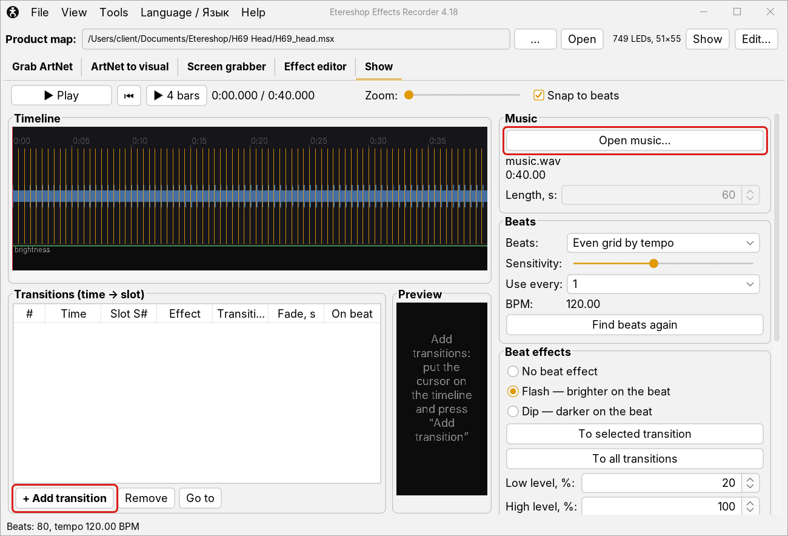

### Several controllers in one product
If your Madrix project sends data to several IP addresses (for example a costume and a separate head piece), every effect you record is also saved to a separate folder for each controller, named by IP address and number of universes. Copy each folder to the memory card of its controller. Folder names can be changed in developer mode (**Mapping → Controllers (IP)**).

### Developer mode
From version 4.15 the window shows only what customers need. The **Mapping** tab, the log and the service tools are hidden until you switch on **Help → Developer mode** (or press **Ctrl+Shift+D**, on a Mac **Cmd+Shift+D**). Switch it off the same way.

Without developer mode, messages appear in one line at the bottom of the window (red when something is wrong). The full log is always written to a file: **Help → Open log folder** (`recorder.log`); please attach it when you report a problem.

Developer mode adds:
- **Mapping** tab: if you are building your own product, open the inner tab **Draw a map** and draw the LEDs; there are instructions inside. After that you can create a test config and test effects (**Config and test effects**), film the product while they play, and load the video in **Map from video** to get a more detailed map.
- **Tools → Check effects…**: what is inside an effect file (frames, length, FPS, universes) and whether it matches `config.txt` and the product map.
- **Tools → Move effects to another map…**: takes a whole folder of `S#.txt` effects made for one product map and fits them to another (for example after a product got more LEDs). *Fit to shape* works for any product; *by rows* is for products with the same rows but a different number of LEDs in them (masks, spheres). The new map and `config.txt` are saved next to the effects.
- **Tools → Merge maps…**: puts the maps of several parts (costume, head piece, wings…) on one grid. Each part either has its own controller (its own IP, universes from 1) or is connected to the same controller as the previous part. The result is one Madrix project with ArtNet devices and a `config.txt` for every controller.
- **Tools → Convert map**: `.mpx` ↔ Patch `.html`.

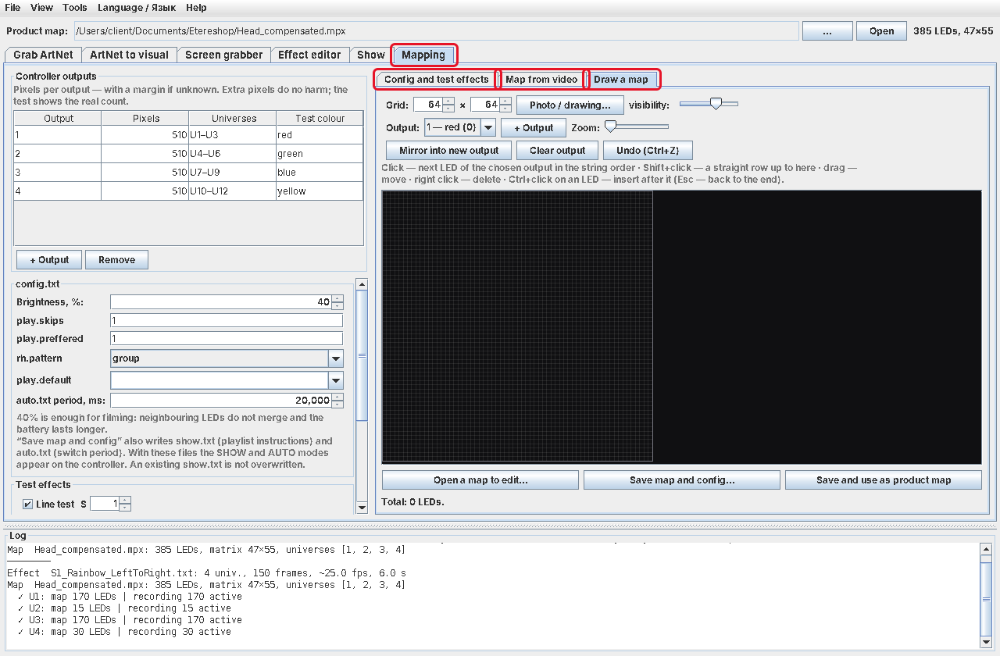

### Using the program with AI apps (MCP)
The program can work as an MCP server, so an AI app can open product maps, preview and record effects, check effects, move effects to another map and merge maps for you. Supported: **Claude Desktop**, **OpenCode** and **Hermes Agent**.

In developer mode open **Tools → Connect to AI (MCP)** and tick the app. The program writes itself into that app's settings (other settings are kept, a `.bak` copy is made); untick to remove it. Then restart Claude Desktop or OpenCode; in Hermes type `/reload-mcp`.

If the settings file has comments, the program does not change it and copies the text to paste to the clipboard instead. By hand it looks like this (use your own folder path):

Claude Desktop (`claude_desktop_config.json`):
```json
{
  "mcpServers": {
    "etereshop-effects-recorder": {
      "command": "C:\\Etereshop Effects Recorder\\runtime\\bin\\java.exe",
      "args": ["-jar", "C:\\Etereshop Effects Recorder\\app\\EffectsRecorder.jar", "--mcp"]
    }
  }
}
```

OpenCode (`~/.config/opencode/opencode.json`):
```json
{
  "mcp": {
    "etereshop-effects-recorder": {
      "type": "local",
      "command": ["java", "-jar", "/path/to/EffectsRecorder.jar", "--mcp"]
    }
  }
}
```

Hermes Agent (`~/.hermes/config.yaml`):
```yaml
mcp_servers:
  etereshop-effects-recorder:
    command: "java"
    args: ["-jar", "/path/to/EffectsRecorder.jar", "--mcp"]
```

Effects are saved to the same effects folder as in the program.

---

## Updates
From version 4.14 the program checks for a new version on GitHub by itself, once a day when it starts, and installs it with one click. Nothing needs to be set up. **Help → Check for updates…** checks right away.

If you have version 4.13 or older, open **Help → Check for updates…** once and enter this address:

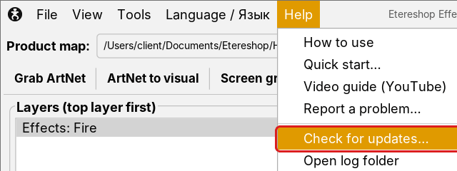

```
https://github.com/etereshop-sales/Etereshop-Effects-Recorder/releases/latest/download/version.json
```

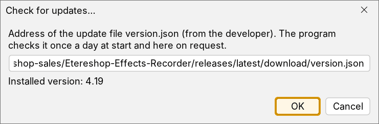

## More documentation
- [LED effects with the Etereshop Screen Grabber](https://github.com/etereshop-sales/LED-Effects-Programming-using-ETERESHOP-Screen-Grabber)
- [Programming LED effects with Madrix](https://github.com/etereshop-sales/Programming-Custom-LED-Effects-with-Madrix-A-User-Friendly-Guide)
- [All about controllers](https://github.com/etereshop-sales/All-about-controllers)
- [Typical problems and product configuration](https://github.com/etereshop-sales/Typical-problems-and-product-configuration)
- Detailed manuals in 7 languages are in the `Manuals` folder inside the archive.

---

**Video guide (informal recording):** https://youtu.be/7uFBYAGUDzY

**The program is in beta development: glitches and lags are possible. Questions and bug reports: sales@etereshop.com**
